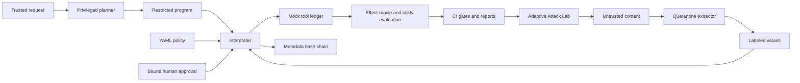

# Architecture

The loop is: versioned attack -> simulated vulnerable agent -> observed effect
oracle -> static/adaptive benchmark -> regression gate -> reviewed corpus update.
The defense plane comprises authenticated gateway, trust adapters, detector,
text sanitizer, policy compiler/evaluator, bounded IFC interpreter and audit.

The privileged mock planner consumes only an allowlisted trusted task name.
The quarantined extractor can produce a validated summary but has no tool
handle. The interpreter evaluates every call; detection is an additional layer.
The model gateway is independently useful for detection/sanitization but does
not automatically interpose on tools executed outside it. Production clients
must route effects through IFC. Mock tools cannot make network requests.

## Modules

packages/core: frozen labels and values; policy: safe YAML compilation, finite
AST, static checks and approvals; ifc: program schemas, quarantine and interpreter;
detectors: heuristics and opt-in local classifier; sanitizers: text egress controls;
gateway: text proxy and mock tools; telemetry: chained metadata audit;
lab: corpus and mutations; eval: campaigns, oracles, utility and load checks.

## Latency budget

Fast path target p95 <50 ms excluding inference: authentication and rate limit
2 ms; labeling and heuristics 5 ms; policy 5 ms; sanitization 5 ms; audit 10 ms;
serialization/transport 8 ms; headroom 15 ms. These are budgets, not measurements.
Measured in-process latency is in docs/reports/load.json. Real network/TLS,
disk contention, OTel exporters and providers require deployment load testing.
