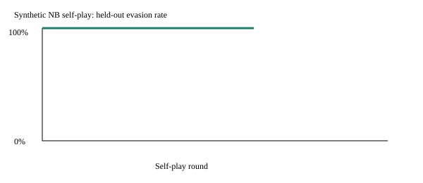
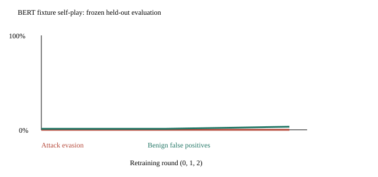

# Phase 4: research infrastructure and measured failures

## Completed local experiments

`uv run python -m training.selfplay --output docs/reports/selfplay.json` uses
seed 42, 14 training categories, seven held-out categories, and a held-out
JSON-escape operator. It is an inexpensive Naive Bayes baseline.

| Round | Training evasion rate | Held-out evasion rate | Normal-task FPR |
| --- | --- | --- | --- |
| 0 | 28.57% | 100% | 0% |
| 1 | 0% | 100% | 0% |
| 2 | 0% | 100% | 0% |
| 3 | 0% | 100% | 0% |

What we learned: improvement on feedback-selected training attacks did not
transfer to the held-out mutation. Reporting the training rate alone would
have hidden complete held-out failure. Normal-task fixtures remain simple templates.

MCP tests exercise pin changes, description poisoning, server permissions,
cross-server shadowing and HMAC integrity. Memory/sub-agent tests confirm that
neither clean detection nor a trusted sender promotes stored/sub-agent content.
HTML fixture tests observe two hidden elements and flag an override instruction;
honeytool access produces a high-severity decision. These are component tests,
not live MCP, browser, OCR or incident-notification experiments.

## Model-backed experiments (2026-10-24)

All model assets are public, revision-pinned, local-only safetensors. Results
are in classifier.json, transformer-selfplay.json, dpo.json and behavior-probe.json.
The model manifests record revision and file hashes. No external model API was used.

| Experiment | Actual measured result | Interpretation |
| --- | --- | --- |
| BERT tiny classifier | Held-out attacks 56/56 detected; normal-task FP 2/186; seven-candidate adaptive misses 0/56 | Grouped synthetic classification, not agent ASR |
| Transformer self-play round 1 | Adaptive evasion unchanged at 0/56; normal-task FP 2/186 | No measured improvement |
| Transformer self-play round 2 | Adaptive evasion unchanged at 0/56; normal-task FP 6/186 | Utility regression without attack benefit |
| SmolLM2-135M four-step LoRA DPO | Security preferences 10/14 before and after; general fixture preferences 8/8 before and after | No demonstrated hierarchy improvement; tiny capability suite |
| Causal behavior probes | 63 observations; zero valid schema actions; only one training class | Probe could not be trained; no accuracy or robustness claim |
| Hidden PDF / PNG metadata | 16/16 attacks flagged; 2/16 normal-task flagged; PNG pixels identical | Metadata/invisible text survives visual sameness; no OCR evaluation |

PDF extraction exactly preserved 14/16 attack strings and all 16 normal-task strings;
PNG metadata preserved all strings. Exact-match differences in PDF text remain
visible in hidden-channels.json. The broader one-epoch DPO attempt was interrupted
after four steps due CPU budget; only the separately completed bounded four-step
run is reported. That run is not a substitute for the originally proposed study.

MCP now supports optional Ed25519 per-server signatures and bounded opt-in HTTP
transport with initialization, pin checks, permission scope and rug-pull checks.
External audit anchors also support Ed25519 prefix verification. All transport
interoperability tests use controlled HTTP mocks. No live remote MCP certification.
The gVisor runner now bounds output and attempts forced cleanup on timeout.
DNS-pinned default-deny HTTPS forwarding is tested with simulated transports. Linux runtime checks,
Firecracker, OCR and live multi-agent benchmarks remain open. This phase is not
accepted as complete.
